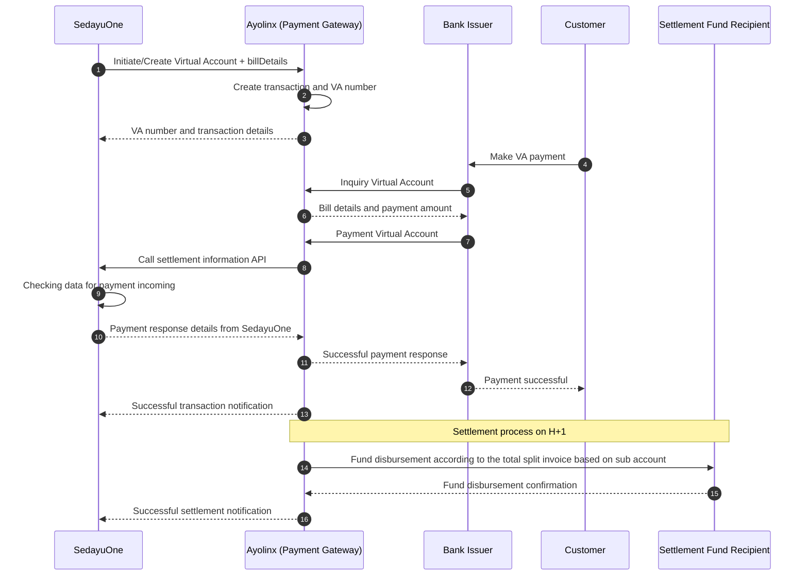

# Sequence Diagram for Virtual Account Payment and Settlement

## Actors

1. **Bank Issuer** — the bank used by the Customer to pay the Virtual Account.
2. **Ayolinx** — the Payment Gateway and Virtual Account transaction manager.
3. **SedayuOne** — the system that initiates the Virtual Account and calculates the settlement allocation.
4. **Customer** — the customer who makes the Virtual Account payment.
5. **Settlement Fund Recipient** — the party that receives fund disbursement from the settlement process.

## Diagram

## Process Flow

1. SedayuOne initiates Virtual Account creation with Ayolinx by including the `billDetails` information.
2. Ayolinx creates the transaction and Virtual Account number based on SedayuOne's request, including the `billDetails` data.
3. The Customer makes a Virtual Account payment through the Bank Issuer.
4. The Bank Issuer sends an inquiry to Ayolinx to validate the Virtual Account and retrieve the bill information.
5. The Bank Issuer forwards the payment to Ayolinx. Ayolinx then calls the SedayuOne API to obtain the settlement value calculated for each settlement fund recipient.
6. Ayolinx sends a successful payment response to the Bank Issuer. The Customer receives a successful payment confirmation, and SedayuOne receives the transaction notification.
7. On H+1, each settlement fund recipient receives funds according to the split invoice based on the sub account.

## Notes

- During Virtual Account initiation, SedayuOne includes the bill details through `billDetails` as the basis for forming the SedayuOne bill detail object.
- The settlement calculation result should be stored together with the transaction ID as the basis for reconciliation.
- Each API request and response should have a unique reference ID to support audit and transaction tracking.
- Retry and idempotency mechanisms are required to prevent duplicate records or fund disbursements.
- If the settlement process fails, Ayolinx must send the failure status to SedayuOne for follow-up.
