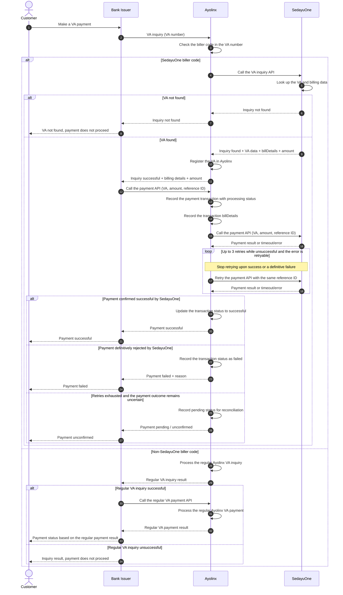

# SedayuOne VA Inquiry and Payment Sequence Diagram

## Actors

1. **Customer** — the customer paying a Virtual Account (VA).
2. **Bank Issuer** — the bank sending inquiry and payment requests to Ayolinx.
3. **Ayolinx** — checks the biller code, registers the VA, stores `billDetails`, and forwards the payment.
4. **SedayuOne** — provides VA billing data and processes the payment.

## Diagram

## Process Flow

1. The Customer makes a VA payment through the Bank Issuer.
2. The Bank Issuer sends a VA inquiry to Ayolinx. Ayolinx checks the VA biller code.
3. If the biller code belongs to SedayuOne, Ayolinx forwards the inquiry to the SedayuOne API.
4. If the VA is not found, an `inquiry not found` response is returned to the Bank Issuer and the Customer. The process stops before payment.
5. If the VA is found, SedayuOne returns the VA data, `billDetails`, and amount. Ayolinx registers the VA before returning a successful inquiry response to the Bank Issuer.
6. The Bank Issuer calls the Ayolinx payment API. Ayolinx records the payment transaction with processing status and the transaction `billDetails`, then forwards the payment to the SedayuOne API.
7. If a retryable temporary error occurs, Ayolinx retries the payment call up to three times. Retries stop immediately upon success or a definitive failure.
8. Once SedayuOne confirms that the payment is successful, Ayolinx updates the transaction status to successful. Ayolinx then returns the successful status to the Bank Issuer, which displays the successful status to the Customer.
9. If the payment is definitively rejected, a failed status is returned. If all attempts are exhausted but the outcome remains unknown, a pending status is returned for follow-up through reconciliation.
10. If the biller code does not belong to SedayuOne, Ayolinx follows its regular VA inquiry process. If the inquiry succeeds, the Bank Issuer proceeds to the payment API and Ayolinx processes the payment through its regular VA flow. The payment result is returned to the Bank Issuer and the Customer. If the inquiry is unsuccessful, payment does not proceed. This branch follows the regular Ayolinx VA mechanism without calling the SedayuOne API.

## Retry Rules

- **Attempt count assumption:** one initial call plus up to **three retries**, for a maximum of four payment calls to SedayuOne.
- Retries apply only to temporary issues, such as timeouts or temporary errors agreed to be retryable. Definitive business rejections are not retried.
- All retries for the same transaction use the **same reference ID / idempotency key**. SedayuOne must process them idempotently to prevent duplicate payment records.
- A timeout does not automatically mean the payment failed; SedayuOne may already have processed the transaction. An uncertain outcome is recorded as pending until reconciliation confirms its status.
- Retry intervals, timeout limits, response code mappings, and the reconciliation mechanism follow the integration agreement between Ayolinx and SedayuOne.
