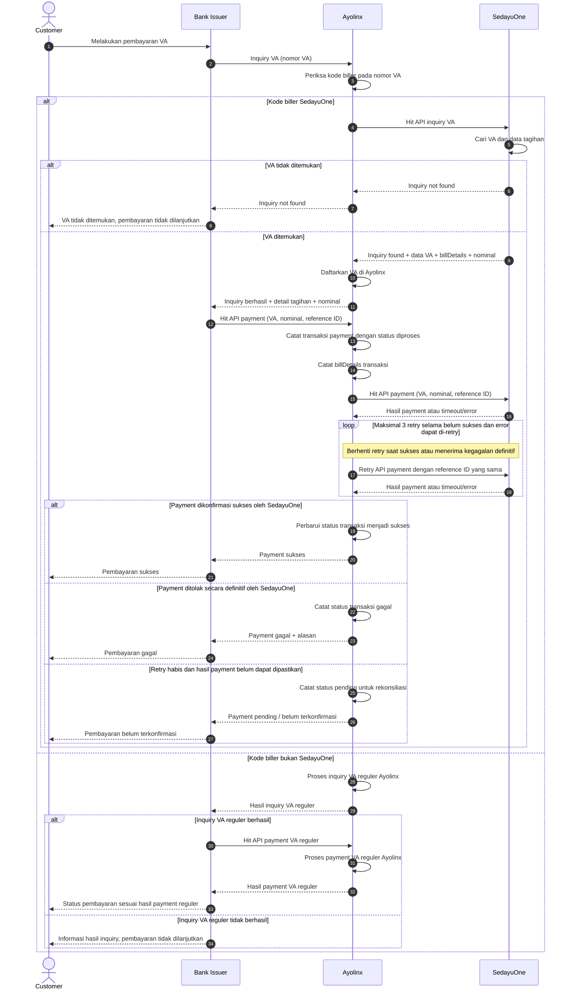

# Sequence Diagram Inquiry dan Payment VA SedayuOne

## Aktor

1. **Customer** — pelanggan yang membayar Virtual Account (VA).
2. **Bank Issuer** — bank yang mengirimkan inquiry dan payment ke Ayolinx.
3. **Ayolinx** — memeriksa kode biller, mendaftarkan VA, menyimpan `billDetails`, dan meneruskan payment.
4. **SedayuOne** — menyediakan data tagihan VA dan memproses payment.

## Diagram

## Urutan Proses

1. Customer melakukan pembayaran VA melalui Bank Issuer.
2. Bank Issuer mengirimkan inquiry VA ke Ayolinx. Ayolinx memeriksa kode biller VA.
3. Jika kode biller adalah SedayuOne, Ayolinx meneruskan inquiry ke API SedayuOne.
4. Jika VA tidak ditemukan, respons `inquiry not found` dikembalikan ke Bank Issuer dan Customer. Proses berhenti sebelum payment.
5. Jika VA ditemukan, SedayuOne mengembalikan data VA, `billDetails`, dan nominal. Ayolinx mendaftarkan VA sebelum mengembalikan inquiry berhasil ke Bank Issuer.
6. Bank Issuer memanggil API payment Ayolinx. Ayolinx mencatat transaksi payment dengan status diproses beserta `billDetails` transaksi, lalu meneruskan payment ke API SedayuOne.
7. Jika terjadi gangguan sementara yang dapat di-retry, Ayolinx mengulangi panggilan payment maksimal tiga kali. Retry berhenti segera setelah sukses atau setelah menerima kegagalan definitif.
8. Setelah SedayuOne mengonfirmasi payment sukses, Ayolinx memperbarui status transaksi menjadi sukses. Ayolinx kemudian mengembalikan status sukses ke Bank Issuer, lalu Bank Issuer menampilkan status sukses kepada Customer.
9. Jika payment ditolak secara definitif, status gagal dikembalikan. Jika percobaan habis tetapi hasilnya belum diketahui, status pending dikembalikan untuk ditindaklanjuti melalui rekonsiliasi.
10. Jika kode biller bukan SedayuOne, Ayolinx menjalankan proses inquiry VA reguler Ayolinx. Jika inquiry berhasil, Bank Issuer melanjutkan ke API payment dan Ayolinx memproses pembayaran melalui alur VA reguler. Hasil payment dikembalikan ke Bank Issuer dan Customer. Jika inquiry tidak berhasil, pembayaran tidak dilanjutkan. Cabang ini mengikuti mekanisme VA reguler Ayolinx tanpa memanggil API SedayuOne.

## Ketentuan Retry

- **Asumsi jumlah percobaan:** satu panggilan awal ditambah maksimal **tiga retry**, sehingga total maksimal empat panggilan payment ke SedayuOne.
- Retry hanya dilakukan untuk gangguan sementara, misalnya timeout atau error sementara yang disepakati dapat di-retry. Penolakan bisnis yang definitif tidak di-retry.
- Semua retry untuk transaksi yang sama menggunakan **reference ID / idempotency key yang sama**. SedayuOne perlu memprosesnya secara idempoten agar pembayaran tidak tercatat ganda.
- Timeout tidak otomatis berarti payment gagal; transaksi mungkin sudah diproses SedayuOne. Hasil yang belum pasti dicatat sebagai pending sampai rekonsiliasi memastikan statusnya.
- Jeda retry, batas timeout, pemetaan kode respons, serta mekanisme rekonsiliasi mengikuti kesepakatan integrasi Ayolinx dan SedayuOne.
